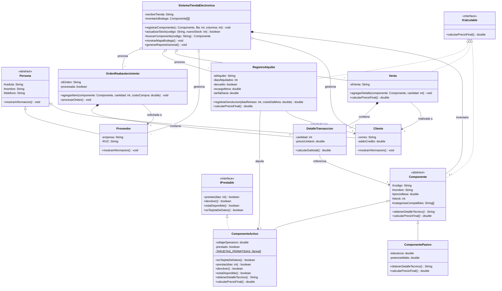

# Sistema de gestión para una tienda de electrónica

Aplicación en Java (proyecto NetBeans) para gestionar una tienda de electrónica: clientes, proveedores, inventario, ventas, alquileres y reabastecimiento.

> **Estado:** en desarrollo. El proyecto compila y se puede ejecutar; el menú principal ya permite gestionar el inventario y la bodega. Los módulos de usuarios, alquileres, reabastecimiento y ventas aún no están conectados al menú.

## Reparto del trabajo

| Persona | Parte |
|---|---|
| Persona 1 | Usuarios y alquileres: `ICalculable`, `IPrestable`, `Persona`, `Cliente`, `Proveedor`, `RegistroAlquiler` |
| Persona 2 | Componentes, inventario y `Main`: `Componente`, `ComponenteActivo`, `ComponentePasivo`, módulo 1 del sistema y el menú |
| Persona 3 | Transacciones y reportes: `DetalleTransaccion`, `Venta`, `OrdenReabastecimiento`, `registrarVenta`, reportes |

## Requisitos

- JDK 25 (configurado en `javac.source` y `javac.target` de `nbproject/project.properties`)
- Apache NetBeans (o Ant, ya que el proyecto incluye `build.xml`)

## Cómo abrirlo

1. Clona el repositorio.
2. En NetBeans: **File → Open Project** y selecciona la carpeta del repositorio (la raíz es el proyecto).
3. La clase principal es `tienda.Main`.

## Estructura del proyecto

```
Sistema-de-gestion-para-una-tienda-de-electronica/
├── README.md
├── .gitignore
├── build.xml
├── manifest.mf
├── nbproject/                      Configuración del proyecto NetBeans
└── src/tienda/
    ├── Main.java                   Punto de entrada
    ├── interfaces/
    │   ├── ICalculable.java        calcularPrecioFinal()
    │   └── IPrestable.java         prestar, devolver, estaDisponible, esTarjetaDeDatos
    ├── modelos/
    │   ├── Persona.java            Clase abstracta (cédula, nombre, teléfono)
    │   ├── Cliente.java            Correo y saldo de crédito
    │   ├── Proveedor.java          Empresa y RUC
    │   ├── Componente.java        Clase abstracta (código, nombre, precio base, stock)
    │   ├── ComponenteActivo.java  Voltaje de operación; se puede prestar (IPrestable)
    │   └── ComponentePasivo.java  Tolerancia y potencia
    ├── servicios/
    │   └── SistemaTiendaElectronica.java   Lógica central de la tienda
    └── transacciones/
        ├── Venta.java
        ├── DetalleTransaccion.java
        ├── OrdenReabastecimiento.java
        └── RegistroAlquiler.java
```
##UML


## Estado actual

| Módulo | Estado |
|---|---|
| Clientes y proveedores (registro y búsqueda) | Implementado |
| Ventas y detalles de transacción | Clases listas; falta `registrarVenta` en el sistema |
| Órdenes de reabastecimiento | Clase lista; faltan `crearOrdenReabastecimiento` y `procesarOrdenRecibida` |
| Alquileres y devoluciones | Implementado en el sistema; falta conectarlo al menú |
| Inventario y bodega | Implementado (matriz `Componente[][]`, stock, búsqueda, mapa) y conectado al menú |
| Componentes (clase base y subclases) | Implementado |

